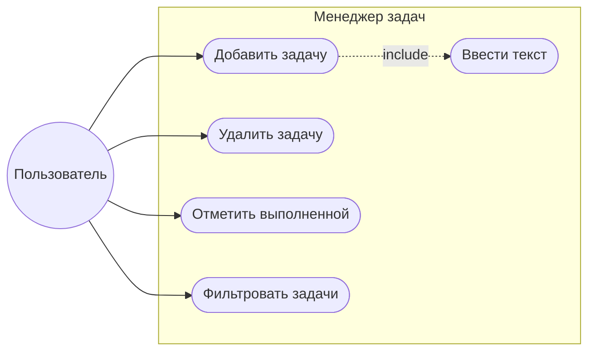

# Chukotka
students pogect
# Менеджер задач (Task Manager)

## Описание
Приложение с графическим интерфейсом для управления списком задач. Позволяет добавлять, удалять, отмечать выполненные задачи и фильтровать их.

## Требования
- Python 3.8+
- Tkinter (входит в стандартную библиотеку)

## Запуск
1. Скачайте репозиторий.
2. Запустите `python main.py` или откройте `main.exe` (в папке bin).

## Функционал
- Добавление задачи.
- Удаление выбранной задачи.
- Переключение статуса "Выполнено".
- Фильтрация: Все / Активные / Выполненные.

